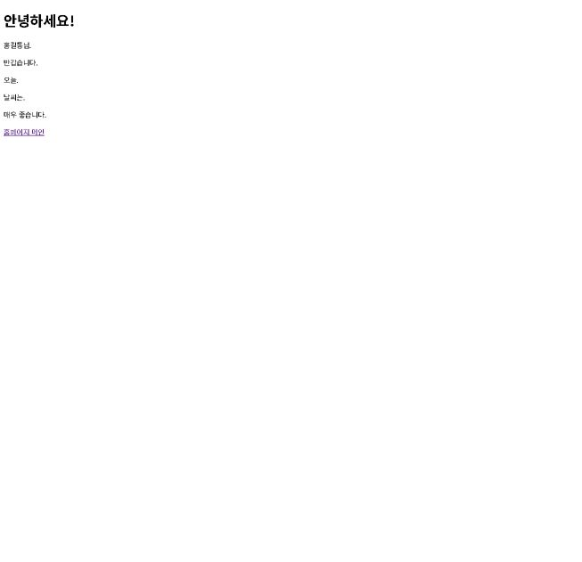

# 자바웹프로그래밍 2주차

> 2026년 9월 10일
>
> 20231145 신동우

## 이번 주에 배운 내용

이번 수업에서는 VS Code로 Spring Boot 개발 환경을 설정하고, Controller와 Thymeleaf를 사용해 웹페이지를 연결해 봤다.

- Java 25, Spring Boot 4.1.1, Maven 프로젝트 생성
- Java와 Spring Boot용 VS Code 확장 프로그램 설치
- Spring Boot 내장 Tomcat을 8080 포트로 실행
- MVC 구조와 DispatcherServlet의 역할 확인
- Controller의 데이터를 Thymeleaf 화면에 출력
- GitHub에 실습 코드 업로드

## 프로젝트 구조와 실행

주요 파일은 다음과 같다.

```text
src/main
├── java/com/example/demo
│   ├── DemoApplication.java
│   └── DemoController.java
└── resources/templates
    ├── index.html
    ├── hello.html
    └── hello2.html
```

[DemoApplication.java](src/main/java/com/example/demo/DemoApplication.java)가 프로그램의 시작점이다. VS Code에서 파일을 열고 `Ctrl + F5`를 누르면 실행할 수 있다.

```powershell
.\mvnw.cmd spring-boot:run
```

- 메인 페이지: `http://localhost:8080/`
- 첫 번째 페이지: `http://localhost:8080/hello`
- 두 번째 페이지: `http://localhost:8080/hello2`

## MVC와 Thymeleaf

브라우저에서 URL을 요청하면 `DispatcherServlet`이 알맞은 Controller를 찾는다. Controller는 Model에 데이터를 담고 화면 이름을 반환하며, Thymeleaf가 그 데이터를 HTML에 넣어 보여 준다.

```java
@GetMapping("/hello")
public String hello(Model model) {
    model.addAttribute("data", "반갑습니다.");
    return "hello";
}
```

```html
<p th:text="${data}"></p>
```

처음에는 `/hello.html`로 직접 연결했지만 404 오류가 났다. `templates` 안의 HTML은 Controller를 통해 연결해야 하고, Model의 속성 이름과 `${...}`의 변수 이름도 같아야 한다는 것을 알게 됐다.

## 2주차 과제

- [hello.html](src/main/resources/templates/hello.html)에 `/hello2` 링크 추가
- [DemoController.java](src/main/java/com/example/demo/DemoController.java)에 `hello2()` 매핑 추가
- 이름, 인사말, 오늘, 날씨, 상태 총 5개 속성을 Model에 저장
- [hello2.html](src/main/resources/templates/hello2.html)에서 5개 값 출력

### 최종 실행 화면



## 느낀 점

직접 URL 매핑을 해 보면서 URL, Controller의 반환값, HTML 파일 이름이 서로 연결된다는 점을 이해했다. Model과 Thymeleaf로 데이터를 전달하는 과정도 실습해 보니 MVC 구조가 전보다 조금 더 익숙해졌다.

---

# 자바웹프로그래밍 3주차

> 2026년 9월 16일  
> 20231145 신동우

## 이번 주 실습 내용

이번 수업에서는 Bootstrap 포트폴리오 템플릿을 Spring Boot 프로젝트에 적용하고, 내 소개와 관심 기술을 담은 개인 포트폴리오로 수정했다.

- HTML 템플릿을 `templates` 폴더에 적용
- CSS, JavaScript, 이미지, 폰트를 `static` 폴더에 분리
- Thymeleaf를 이용해 정적 파일과 페이지 경로 연결
- 메뉴와 자기소개를 한글로 수정하고 프로필 이미지 적용
- 웹, AI, 보안, 게임의 4개 기술 영역과 아이콘 구성
- 기술별 상세 페이지를 `public` 폴더에 추가
- PC와 모바일 화면에서 반응형 레이아웃 확인

## 주요 프로젝트 구조

```text
src/main/resources
├── templates
│   └── index.html
├── public
│   ├── detailed_web.html
│   ├── detailed_ai.html
│   ├── detailed_security.html
│   └── detailed_game.html
└── static
    ├── css
    ├── fonts
    ├── images
    └── js
```

`templates`의 메인 화면은 Thymeleaf가 처리하고, `static`은 CSS나 이미지 같은 정적 파일을 보관한다. 별도의 Controller가 필요 없는 기술 상세 페이지는 `public`에 작성했다.

## 포트폴리오 구현

메인 페이지에는 이름, 전공, 관심 분야와 학습 목표를 작성했다. 기술 영역은 웹, 인공지능, 보안, 게임으로 나누고 각 영역에 맞는 Bootstrap 아이콘을 사용했다.

각 카드의 `자세히 보기` 버튼을 누르면 기술별 상세 페이지가 새 창으로 열린다. 새 창에서 기존 페이지를 조작하지 못하도록 다음 속성도 함께 사용했다.

- 메인 페이지: `http://localhost:8080/`
- 웹 상세 페이지: `http://localhost:8080/detailed_web.html`
- AI 상세 페이지: `http://localhost:8080/detailed_ai.html`
- 보안 상세 페이지: `http://localhost:8080/detailed_security.html`
- 게임 상세 페이지: `http://localhost:8080/detailed_game.html`

## 느낀 점

완성된 템플릿을 Spring Boot 구조에 맞게 옮기면서 `templates`, `static`, `public` 폴더의 차이를 이해할 수 있었다. 같은 디자인을 재활용해 여러 상세 페이지를 만들고 모바일 화면까지 확인하면서, 웹페이지를 구조적으로 관리하는 방법을 배웠다.

---

# 자바웹프로그래밍 4주차

> 2026년 9월 23일
>
> 20231145 신동우

## 이번 주 실습 내용

이번 수업에서는 Spring Boot와 MySQL을 연결하고, DB에 저장한 사용자 목록을 웹페이지에 출력했다. (강의자료 29페이지까지)

- JPA와 MySQL Connector를 설정하고 `spring` 데이터베이스 연결
- Controller, Service, Repository, Entity로 역할 분리
- `TestDB` 엔티티로 `testdb` 테이블 자동 생성
- `findAll()`로 전체 사용자를 조회하고 `th:each`로 표에 출력

## 데이터가 화면에 나오는 과정

`/testdb` 요청 → Controller → Service → Repository → MySQL 조회 → Model에 저장 → `testdb.html` 출력

Controller에서 목록을 `users`로 전달하고, 화면에서는 다음 코드로 아이디와 이름을 출력했다.

```html
<tr th:each="user : ${users}">
    <td th:text="${user.id}"></td>
    <td th:text="${user.name}"></td>
</tr>
```

## 실행 결과

실행 전 MySQL에 `spring` DB를 만들고, 프로젝트 최상위의 `application-local.properties`에 `spring.datasource.password=본인_DB_비밀번호`를 설정한다. 이 파일은 GitHub 업로드에서 제외된다. 파일 없이 실행할 때는 `DB_PASSWORD` 환경변수를 설정해도 된다.

[실습 SQL](docs/sql/week4-testdb.sql)로 **홍길동**, **아저씨**를 추가한 뒤 [사용자 목록 페이지](http://localhost:8080/testdb)에서 정상 출력을 확인했다. 기존 메인 화면과 Hello 페이지도 정상 작동했다.


## 느낀 점

역할별로 파일을 나누면서 요청과 데이터 조회의 흐름을 이해했다. DB에 저장한 값이 화면에 나오는 것을 보니 JPA와 Thymeleaf의 연결 과정이 더 잘 와닿았다.
